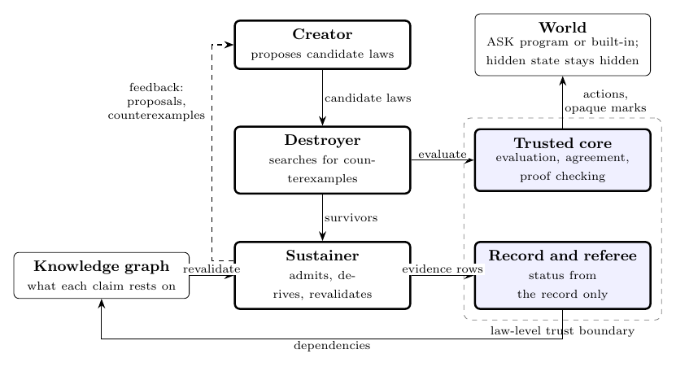

# MIYOG

**A trust-separated architecture for computational discovery in finite formal worlds.**

This is the public companion to the paper *MIYOG: A Trust-Separated Architecture for Computational Discovery in Finite Formal Worlds* (Amogh Sai Krishnan, 2026). It explains the architecture, the ASK world language and the paper's evidence. **It does not contain the MIYOG engine**, and it is not a reproducible release of the system described in the paper.

- Paper: arXiv link to be added on publication.
- Citation: see `CITATION.cff`.
- Licence: none selected yet. See `NOTICE.md`.

## What MIYOG investigates

A predictive model estimates what is likely to happen next. Scientific reasoning asks what can happen, what must happen, what cannot, and why. Each of those needs a different kind of evidence. MIYOG is an implemented architecture that tests some of these evidential obligations in small formal worlds.

Its central design choice separates two jobs: producing a candidate explanation, and deciding what may be claimed about it.

- A **Creator** proposes equational laws.
- A **Destroyer** searches for counterexamples.
- A **Sustainer** admits survivors, derives laws from a basis, and re-examines dependent claims when a premise falls.
- A fingerprinted **trusted core** alone evaluates, checks proof certificates and assigns each law one of eight outcome kinds, reading only an append-only record.

Worlds are written in **ASK**, a small bounded language. The engine sees only actions and opaque observation marks; hidden state never reaches it.

## What the paper establishes, and what it does not

- The recorded evidence comes from small generated worlds. Most results come from benchmark runs whose generating code was not retained, so **none has been independently reproduced**. See `REPRODUCIBILITY.md`.
- The architecture's guarantees are bounded: exhaustive checks cover stated finite domains, and mechanism identification is bounded by sequence length and hypothesis size.
- Trust separation is complete for equational laws only. Discovery modules decide acceptance by their own rules.
- MIYOG makes no claim about general intelligence, physical laws or open mathematical problems.

## Contents

| Path | Contents |
|---|---|
| `docs/OVERVIEW.md` | Research question, scientific-intelligence framing, scope |
| `docs/TRINITY.md` | High-level account of the law loop |
| `docs/ASK_OVERVIEW.md` | The ASK language at the level described in the paper |
| `examples/fuse3.ask` | The worked ASK example from the paper |
| `diagrams/` | Trinity overview diagram (SVG, PNG, TikZ source) |
| `REPRODUCIBILITY.md` | Evidence tiers and limitations |
| `CITATION.cff` | Citation metadata |

## Contact

Amogh Sai Krishnan, independent researcher. Questions about the work or access to the research code: contact the author.
